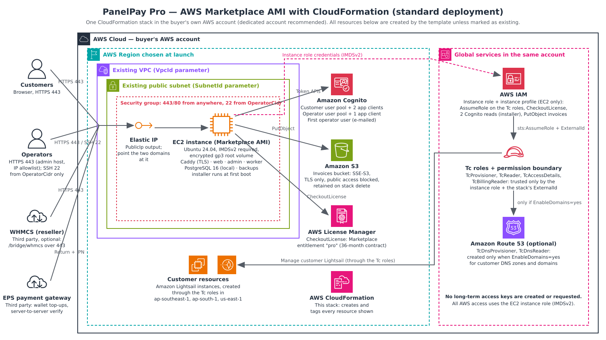

# TryAWS.now Pro: install guide

TryAWS.now Pro is the open-source TryAWS.now panel packaged for **one Amazon EC2 instance in your own AWS
account**, installed by **one AWS CloudFormation stack**. It is sold on AWS Marketplace by TiCON System Limited.

> **Status: coming soon on AWS Marketplace.** Version 1.0.0 is in AWS Marketplace review. This page will link the
> listing as soon as it is public. Until then you can read every file of the Pro edition in this repository.

## Open source or Pro?

|               | Open source (this repository)                                    | Pro on AWS Marketplace                                                                           |
| ------------- | ---------------------------------------------------------------- | ------------------------------------------------------------------------------------------------ |
| Price         | Free, Apache-2.0                                                 | $199 for a 36-month contract, billed through your AWS account                                    |
| Where it runs | Your AWS Organization (Lambda, RDS, SQS, ...), deployed with SST | One EC2 instance in one AWS account                                                              |
| Install       | You build, configure and deploy                                  | One CloudFormation stack, about 15 minutes                                                       |
| WHMCS         | Addon in [pro/whmcs](../pro/whmcs)                               | Same addon, shipped on the AMI                                                                   |
| Updates       | `git pull`                                                       | Packaged updates while the contract is active; the installed version keeps running after it ends |
| Support       | [GitHub issues](https://github.com/bemoshiur/tryaws.now/issues)  | Vendor support: business@ticonsys.com                                                            |
| Refunds       | Not applicable                                                   | Full refund if requested within 24 hours of purchase                                             |

Both editions are built from the same code.

## What the stack creates

One stack ([pro/cfn/tryawsnow-pro.yaml](../pro/cfn/tryawsnow-pro.yaml), generated by
[pro/cfn/build-template.mjs](../pro/cfn/build-template.mjs)) creates:

- **The EC2 instance** from the Pro AMI (Ubuntu 24.04, IMDSv2 required, encrypted gp3 root volume) in the VPC and
  public subnet you choose, with an **Elastic IP**.
- **A security group**: 443 and 80 open to everyone, SSH 22 only from the operator CIDR you enter.
- **An instance role** (EC2 only). It can assume the Lightsail access roles below, check your AWS Marketplace
  licence (`license-manager:CheckoutLicense` and `CheckInLicense`), read the two Cognito app-client secrets once at install, and write
  invoice PDFs to the invoices bucket. **No access keys are created or requested.**
- **Four Lightsail access roles** (`TcProvisioner`, `TcReader`, `TcAccessDetails`, `TcBillingReader`) with a
  permission boundary. They trust only the instance role plus an ExternalId unique to the stack.
- **Two Route 53 roles** (`TcDnsProvisioner`, `TcDnsReader`), only when you set `EnableDomains=yes`.
- **Two Amazon Cognito user pools**: one for customers (two app clients) and one for operators (MFA required),
  plus your first operator user.
- **An Amazon S3 bucket** for invoices: SSE-S3, TLS only, public access blocked.

The user pools and the invoices bucket are **kept** if you delete the stack, so you do not lose customer accounts
or invoices by accident.

## Before you launch

1. **Use an AWS account dedicated to TryAWS.now** (for example a new member account in your AWS Organization).
   The Lightsail access roles can change every Lightsail resource of the account, and the Route 53 roles every
   hosted zone. Keep your own servers and domains in another account.
2. **Have two domain names ready**, one for the customer panel (for example `panel.example.com`) and one for the
   operator panel (for example `admin.example.com`). You must be able to edit their DNS.
3. **Pick a VPC and a public subnet** (a subnet with a route to an internet gateway). The default VPC works.
4. **Know your office IP** as a CIDR, for example `203.0.113.7/32`. It can be no wider than `/8`.

## Launch

1. Subscribe on AWS Marketplace and choose the **"One-click install: TryAWS.now Pro stack"** delivery option.
2. Fill in the parameters:

| Parameter           | What to enter                                                                         |
| ------------------- | ------------------------------------------------------------------------------------- |
| `PanelDomain`       | Customer panel domain, e.g. `panel.example.com`                                       |
| `AdminDomain`       | Operator panel domain, e.g. `admin.example.com`                                       |
| `OperatorEmail`     | First operator. Cognito e-mails the temporary password here; also the TLS contact     |
| `OperatorCidr`      | Your office IP range, e.g. `203.0.113.7/32`. SSH and the operator panel allow only it |
| `KeyName`           | Optional EC2 key pair for SSH                                                         |
| `ImageId`           | Filled in by AWS Marketplace                                                          |
| `InstanceType`      | `t3.medium` recommended; `t3.small` minimum                                           |
| `RootVolumeGiB`     | 30 GiB default                                                                        |
| `VpcId`, `SubnetId` | The VPC and its public subnet                                                         |
| `DedicatedAccount`  | `yes` (confirms the account is used only for TryAWS.now)                              |
| `EnableDomains`     | `yes` only if you will sell DNS zones and domains                                     |

3. Acknowledge that the stack creates named IAM roles, and create the stack. It takes about 5 minutes. The
   installer then runs on the instance for about 10 more minutes.

## After launch

1. From the stack **Outputs**, copy `PublicIp`. Create DNS **A records** for `PanelDomain` and `AdminDomain` that
   point to it. TLS certificates are issued automatically once DNS resolves.
2. Open `https://<AdminDomain>` from your office network. Sign in with the temporary password Cognito e-mailed to
   you, set a new password, and set up an authenticator app (operators always use MFA).
3. In the operator panel, review prices and settings, then share `https://<PanelDomain>` with your customers.

## WHMCS

The WHMCS addon lets your WHMCS clients open the panel with their e-mail filled in, and pay wallet top-ups through
WHMCS invoices that the panel verifies server to server before crediting.

1. Connect with SSH (from `OperatorCidr`) and run `sudo tc-install` again with the three WHMCS answers.
2. Copy `/opt/tc/current/whmcs/modules/addons/tryawsnow/` into your WHMCS `modules/addons/`, activate
   **TryAWS.now Panel** and paste the bridge secret.

Full steps: [pro/whmcs/README.md](../pro/whmcs/README.md) and the box guide
[pro/box/README.md](../pro/box/README.md#whmcs-bridge-pro-6).

## What it costs to run

You pay AWS directly for what the stack runs in your account: the EC2 instance, its EBS volume, the Elastic IP,
S3 storage and Cognito above its free tier. Customer Lightsail resources are created in your account and billed
to it as well, which is what you resell. Use the [AWS Pricing Calculator](https://calculator.aws/) for your Region
and instance type.

## Limits of this version

- Customer Lightsail resources are created in `ap-southeast-1`, `ap-south-1` and `us-east-1`.
- Cognito's default e-mail sender allows **50 e-mails a day** for the account. For more, switch both user pools
  to Amazon SES.
- The role names are fixed, so install **one stack per AWS account**.
- First-boot log: `/var/log/tc-firstboot.log`.

## Rotating credentials

The installer generates every secret of the instance itself: the five database passwords, the owner
password, the local invoke token, the WHMCS bridge secret and the app keys. They live in root-only files
under `/etc/tc` and are never printed. To give all of them new values:

1. Connect to the instance with SSH from your operator range and run
   `sudo tc-install --rotate`. It keeps your answers, generates new secrets, sets the new database
   passwords, rewrites the configuration and restarts the services. One-time codes that were
   already sent stop working. If the run stops, run `sudo tc-install --rotate` again.
2. If the WHMCS addon is on, open **Addons > TryAWS.now Panel** in WHMCS and paste the new bridge secret
   from `/etc/tc/bridge-secret.txt`.
3. To change the WHMCS API credential, create a new one in WHMCS, delete `WHMCS_API_IDENTIFIER` and
   `WHMCS_API_SECRET` from `/etc/tc/answers.env`, and run `sudo tc-install` to be asked for them again.

There are no AWS access keys to rotate: the instance uses its instance role. The two Cognito app-client
secrets belong to your user pools; after you rotate them in Amazon Cognito, delete `/etc/tc/.cognito`
and run `sudo tc-install` to read them again. Rotate after any suspected exposure and at least once a year.

## Security

The design and its security review are in [pro/box/README.md](../pro/box/README.md). Report a vulnerability as
described in [SECURITY.md](../SECURITY.md).

## Support

- Pro: **business@ticonsys.com**, or book a call at <https://cal.com/ticonsys/meeting>.
- Open source: [GitHub issues](https://github.com/bemoshiur/tryaws.now/issues).

---

_TryAWS.now Pro is built and supported by TiCON System Limited. AWS, Amazon EC2, Amazon Lightsail, Amazon Cognito,
AWS CloudFormation and AWS Marketplace are trademarks of Amazon.com, Inc. or its affiliates._
